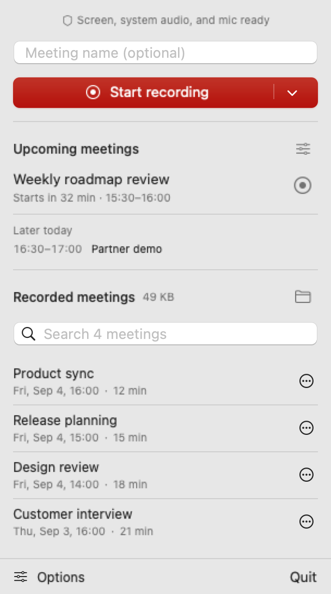

# Better Meeting

Better Meeting records a display, system audio, and your microphone from the
macOS menu bar. When you stop, it transcribes the audio on your Mac with
Parakeet or Whisper. Each meeting gets its own folder with the recording and a
Markdown transcript.

Project website: [kremnyi.github.io/better-meeting-menubar](https://kremnyi.github.io/better-meeting-menubar/)



The app's menu, shown with fictional calendar events and meetings.

- [Requirements](#requirements)
- [Install with Homebrew](#install-with-homebrew)
- [Permissions](#permissions)
- [Privacy and model storage](#privacy-and-model-storage)
- [Record a meeting](#record-a-meeting)
- [Features](#features)
- [Options](#options)
- [Saved meetings](#saved-meetings)
- [Update the app](#update-the-app)
- [Uninstall](#uninstall)
- [Limits](#limits)
- [Build from source](#build-from-source)
- [Project origin and license](#project-origin-and-license)

## Requirements

- A Mac with Apple Silicon and macOS 15 or later.
- Disk space for one speech model. The default Parakeet v3 model is about
  470 MB. Whisper models are about 490 MB (Small), 1.6 GB (Large v3 Turbo,
  the Whisper default), or 3.1 GB (Large v3). Speaker labels add about 11 MB.
- Free space for recordings. The app does not start a recording with less than
  250 MB free and warns below 2 GB. If free space falls below 250 MB during a
  recording, the app stops and saves it, then transcribes it.

## Install with Homebrew

```bash
brew tap --custom-remote kremnyi/better-meeting https://github.com/kremnyi/better-meeting-menubar
brew install --cask kremnyi/better-meeting/better-meeting
open -a "Better Meeting"
```

The cask downloads the app from [GitHub Releases](https://github.com/kremnyi/better-meeting-menubar/releases)
and verifies its SHA-256 checksum.

### Direct download

Download the ZIP from [GitHub Releases](https://github.com/kremnyi/better-meeting-menubar/releases),
extract it, and move the app to `/Applications`. Xcode is not required.

### First launch

Releases use a self-signed certificate. They have no Apple Developer ID and are
not notarized. If macOS blocks the first launch, try to open the app once, then
go to **System Settings → Privacy & Security** and click **Open Anyway**. See
[Apple's instructions](https://support.apple.com/102445). Managed Macs may not
allow this exception. All releases use the same certificate, so macOS
recognizes the app after updates.

## Permissions

- **Screen & System Audio Recording** (required): captures the display and the
  meeting audio. Audio-only recordings need it too, for system audio. After you
  grant it, use **Restart Better Meeting** in the menu.
- **Microphone** (required): records your side of the meeting.
- **Notifications** (optional): recording warnings and transcription results.
  The app asks when your first recording starts.
- **Calendars** (optional): full read access, which macOS requires to read
  events. The app asks only when you turn on **Use calendar** in
  **Options → Meetings** and then click **Allow calendar access**. It never
  edits events.

If access is blocked, the menu shows **Open System Settings**. Automatic meeting
detection needs no extra permission: macOS only reports that some app uses the
microphone, not what it records.

## Privacy and model storage

Recording, transcription, speaker labels, screenshots, screen text (OCR), and
automatic naming run on your Mac. The app does not upload meetings, transcripts,
or calendar details. Only two things use the network:

- **Model downloads.** Speech and speaker models download from Hugging Face
  once per selected model. After that, transcription works offline.
- **Updates.** The app checks GitHub for updates and downloads them from there.

**Open in** gives a meeting to Claude app, Claude Code, Codex app, or Codex CLI. The app
sends nothing itself. The AI app uploads the transcript to Anthropic or OpenAI
only when you send a message there.

Models are stored in `~/Library/Application Support/BetterMeeting/models/`.
**Options → Advanced transcription → Models** lists each model with its size,
and lets you download or delete it. A deleted model downloads again the next
time it is needed. Uninstalling the app keeps models; see [Uninstall](#uninstall).

## Record a meeting

1. Click the Better Meeting icon in the menu bar.
2. Type a meeting name, or leave it empty for an automatic name.
3. Click **Start recording**, or press Return. To record only system audio and
   microphone, open the arrow beside the button and choose **Record audio-only**.
4. Click stop when the meeting ends. The app transcribes the recording, then
   lists the meeting in the menu. Click it to open the transcript.

To discard a recording, click **Cancel recording** and confirm. The recording
moves to the Trash without transcription.

The first time, the app downloads the speech model in the background. You can
record during setup; transcription waits until the model is ready. While a
recording runs, the Mac does not sleep from inactivity.

## Features

- Screen recording or audio-only recording, with live microphone and
  system-audio meters.
- Warnings for silent or disconnected sources and low disk space, also as
  notifications when the menu is closed.
- Local transcription with Parakeet v3 (25 European languages, automatic
  language detection) or Whisper (more languages, one pass per selected
  language).
- Optional speaker labels (**Speaker 1**, **Speaker 2**) from SpeakerKit. They
  are on by default and describe voices in one meeting, not real names.
- Automatic meeting titles from the transcript, with Apple's `NaturalLanguage`
  framework.
- Calendar integration: upcoming meetings in the menu, one-click recording named
  after the event, and links to join Google Meet, Zoom, or Teams calls.
- Recording suggestions when a calendar meeting starts, or when another app uses
  the microphone. Both are off by default.
- Search across meeting titles and transcript text, including your own edits.
- Rename, re-transcribe with other settings, copy the transcript, show in
  Finder, or move a meeting to the Trash.
- **Open in** Claude app, Claude Code, Codex app, or Codex CLI: starts a new,
  empty conversation with the meeting attached, so you write the prompt there.
  The Claude app gets `transcript.md` as an attachment; the Codex app opens the
  meeting folder; the two CLIs start in Terminal in the meeting folder.
- Retry or resume unfinished transcriptions, one at a time or all together.
- Export bundles with screenshots, screen text, and a timeline for use with
  other tools.
- In-app updates with Sparkle, with optional beta releases.

## Options

Open **Options** in the bottom-left corner of the menu.

- **Recording**: display, microphone, and video resolution and frame rate.
- **Files**: save folder, and automatic export of screenshots and screen text.
- **Meetings**: calendar access and calendars, next meeting in the menu bar, and
  recording suggestions.
- **Advanced transcription**: engine, languages, model, vocabulary hints,
  decoding, speaker labels, and downloaded models.
- **App & updates**: launch at login, recording time in the menu bar, updates,
  beta releases, and **About Better Meeting**.

## Saved meetings

Meetings are saved in `~/Documents/Better Meetings` by default. Change the folder
in **Options → Files**. Each meeting has its own folder:

```text
2026-09-04 14.30.00 — Product sync/
├── recording.mp4       screen recording (recording.mov for audio-only)
├── audio.m4a           audio used for transcription
├── transcript.md       transcript with timestamps
├── transcript.json     timed segments, language tags, speaker IDs
├── metadata.json       title, date, duration, settings, status
└── pass_uk.json        Whisper cache for one language pass
```

Some meetings also have `speaker_turns.json` (speaker labels), `calendar.json`
(started from a calendar event), or `artifacts/` (export bundle). The `pass_*.json`
files are safe to delete. See [docs/calendar-data.md](docs/calendar-data.md) for
calendar data.

You can edit `transcript.md`. Search and **Copy Transcript** use your edits.
**Re-transcribe…** replaces the transcript, including your edits.

## Update the app

**Options → App & updates** shows the installed version, release notes, and
**Check for Updates**. Turn on **Download updates automatically** to check in the
background; it is off by default. Turn on **Include beta releases** to also get
beta builds. Sparkle verifies each update with a separate signing key. An update
waits until recording and processing finish.

With Homebrew, finish any recording, quit the app, and run:

```bash
brew update
brew upgrade --cask kremnyi/better-meeting/better-meeting
```

## Uninstall

Uninstalling never deletes saved meetings.

- Homebrew: `brew uninstall --cask kremnyi/better-meeting/better-meeting`. Add
  `--zap` to also remove downloaded models and app settings.
- Direct download: delete the app from `/Applications`. To remove models,
  delete them first in **Options → Advanced transcription → Models**, or delete
  `~/Library/Application Support/BetterMeeting/`.

## Limits

- Video capture records one whole display. Window-only capture is not available.
- Transcription and export run one at a time. You can record while a
  transcription runs.
- Speaker labels can need correction. The app does not name speakers.
- Force Quit or power loss during a recording can leave a video that cannot be
  recovered. To quit while the app is working, choose **Finish and quit** or
  **Wait and quit**.
- Whisper can produce text during silence.
- Parakeet v3 supports 25 European languages. Choose Whisper for other languages.
- File import, live captions, and meeting summaries are not included.
- The selected microphone, and for video the selected display, must be
  connected when recording starts.

## Build from source

Source builds require Xcode 16 or newer. See [CONTRIBUTING.md](CONTRIBUTING.md)
for building, testing, signing, publishing releases, and updating the website.

## Project origin and license

This macOS app is based on [GivenFLY/better-meeting](https://github.com/GivenFLY/better-meeting),
which processes existing recordings. The macOS app is made by
[Bohdan Kremnyi](https://kremnyi.com).

Licensed under [Apache License 2.0](LICENSE). See [NOTICE](NOTICE) for attribution.

Third-party credits: [WhisperKit and SpeakerKit](https://github.com/argmaxinc/argmax-oss-swift)
by Argmax (MIT), [FluidAudio](https://github.com/FluidInference/FluidAudio)
(Apache-2.0), and [Sparkle](https://github.com/sparkle-project/Sparkle) (MIT).
[Parakeet TDT 0.6B v3](https://huggingface.co/nvidia/parakeet-tdt-0.6b-v3) model
weights are © NVIDIA Corporation, CC-BY-4.0. See
[ThirdPartyNotices.md](ThirdPartyNotices.md) for full license details.
